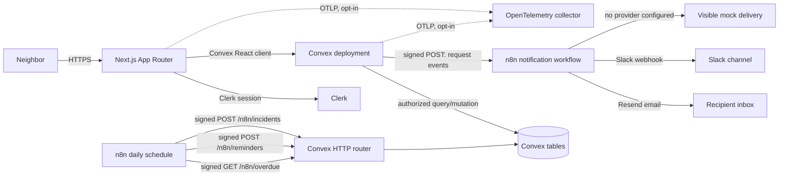
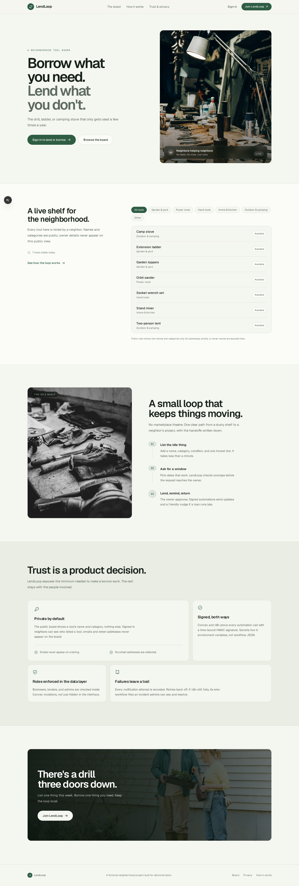
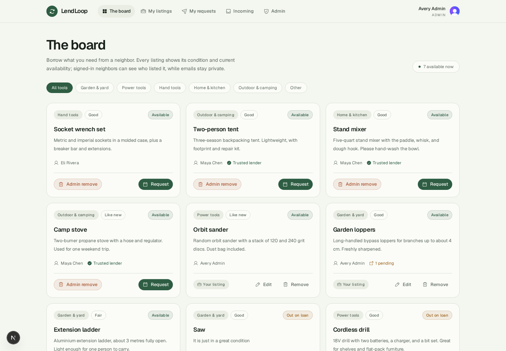
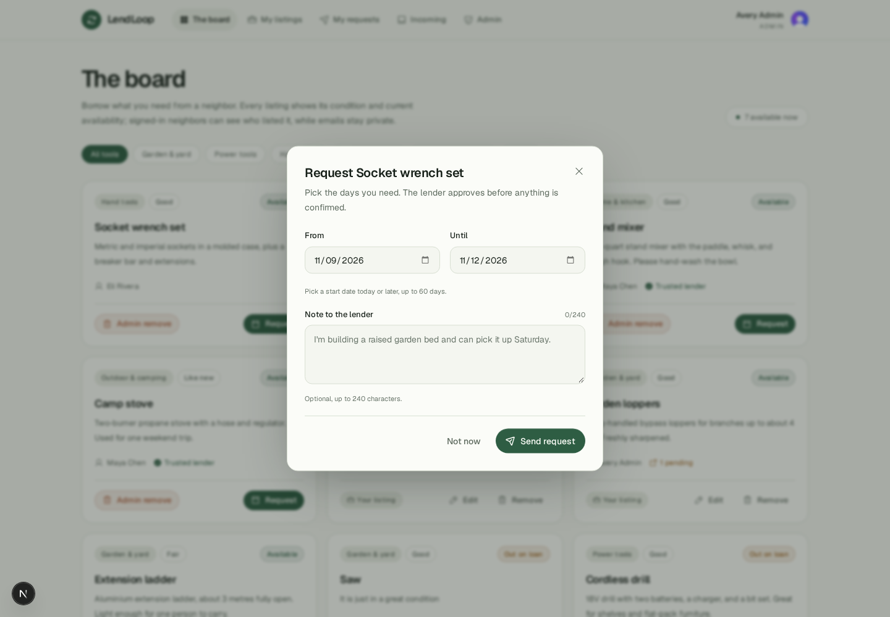
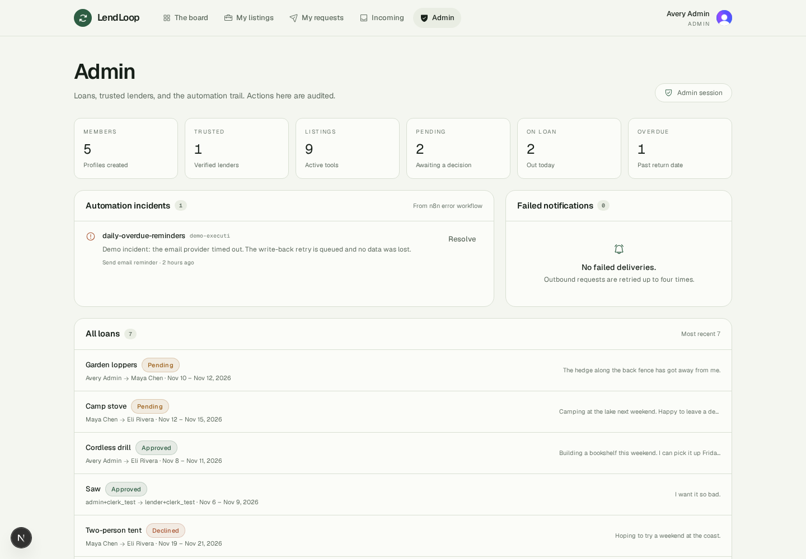

# LendLoop

A neighborhood tool-lending board for the things that sit idle. Borrow what you need, lend what you don't, and let signed automations handle the handoffs.

LendLoop is a full-stack reference implementation of a small trust-first marketplace: a public read-only shelf, authenticated listings and requests, role-based administration, and two-way automation between Convex and n8n without exposing secrets in code or workflow exports.

## Stack

| Layer          | Choice                                          | Why                                                                              |
| -------------- | ----------------------------------------------- | -------------------------------------------------------------------------------- |
| App            | Next.js 16 App Router, React 19, TypeScript     | Server-first rendering, route-level auth, one deployable surface                 |
| Identity       | Clerk                                           | Hosted sign-in and a Convex-compatible JWT                                       |
| Data and authz | Convex                                          | Transactional mutations, reactive queries, server functions as the RBAC boundary |
| Automation     | n8n + Postgres, optional Resend                 | Durable scheduled workflows, visible executions, retries, per-recipient email    |
| UI             | Tailwind CSS v4, Radix Dialog, Phosphor, Sonner | Accessible primitives without a component-library lock-in                        |
| Observability  | OpenTelemetry (opt-in)                          | Provider-neutral OTLP export; no vendor SDK or DSN required                      |
| Tests          | Vitest, convex-test, Playwright                 | Domain, RBAC, workflow-contract, and browser tests with committed reports        |

Design notes: [ADR index](./docs/adr/README.md) and [AI guardrails for a future admin summary](./docs/AI_GUARDRAILS.md).

## What is implemented

- Public landing page with a live read-only tool board. It exposes **tool name and category only** and hides tools currently on loan.
- Clerk sign-in and sign-up, plus a protected `/app` workspace.
- List a tool with name, category, condition, and a short description.
- Browse available tools, filter by category, and request inclusive date ranges.
- Approve or decline requests on your own tools; cancel your pending or approved requests.
- Mark approved loans returned from either side.
- My listings, my requests, incoming requests, and an admin console.
- Roles enforced in Convex functions, not only in the UI.
- Admin actions: remove any listing, view all loans, mark a lender trusted, inspect failed notifications and resolve automation incidents.
- Signed request/status notifications from Convex to n8n, with per-recipient Resend email, shared Slack, and visible mock fallbacks.
- Daily overdue reminder workflow that fetches overdue loans from Convex, emails or messages the borrower, and writes results back with idempotency.
- Error workflow that posts failed n8n executions into the admin incident queue.
- Signed-endpoint replay protection and a fixed-window webhook rate limit, plus opt-in OpenTelemetry export.
- Recent automation activity is shown on each loan card ("Overdue reminder sent 2 days ago").

## Architecture



The Next.js app never writes to Convex tables directly. All reads and writes go through Convex queries and mutations, which resolve the Clerk identity and enforce ownership and role rules. n8n is an untrusted external caller until its HMAC signature and timestamp pass verification.

## Roles and authorization

| Capability                            | Signed-in member | Tool owner    | Borrower | `admin`           |
| ------------------------------------- | ---------------- | ------------- | -------- | ----------------- |
| Public board (name and category)      | yes              | yes           | yes      | yes               |
| Create / edit / remove own listing    | yes              | yes           | yes      | yes               |
| Remove any listing                    | no               | no            | no       | yes               |
| Request someone else's tool           | yes              | no (own tool) | yes      | yes               |
| Approve / decline request on own tool | no               | yes           | no       | only own tools    |
| Cancel own pending/approved request   | no               | no            | yes      | only own requests |
| Mark approved loan returned           | no               | yes           | yes      | only own loans    |
| View all loans and automation state   | no               | no            | no       | yes               |
| Mark a lender trusted                 | no               | no            | no       | yes               |

`tool owner` and `borrower` describe a member's relationship to a specific loan, not separate account roles. The same member can own one tool and borrow another. Admins still act through the same ownership checks for approve, cancel, and return; their extra powers are the admin-console actions listed below.

The public board deliberately hides owner identity. Authenticated list views expose the owner name and trusted-lender mark because that is the decision context. Emails are not rendered on the public board or workspace boards; the admin console shows member email alongside role and trust controls for accountability.

Admin role is bootstrapped from a **verified Clerk JWT email** matching `ADMIN_EMAILS`. The role is stored on the user row for fast reads, but it can only be elevated through that server-side path. Removing an email from `ADMIN_EMAILS` does not demote an existing admin; this is a deliberate lockout safety measure and should be handled as an explicit production change.

### Server-side enforcement map

| Convex function                                                  | Enforcement                                                                                                            |
| ---------------------------------------------------------------- | ---------------------------------------------------------------------------------------------------------------------- |
| `tools.listPublic`                                               | Public by design; returns only `name` and `category`                                                                   |
| `tools.list`, `tools.listMine`                                   | `requireViewer`; list is read-only and listMine filters to the viewer                                                  |
| `tools.create`, `tools.update`                                   | `requireViewer`; update additionally checks `ownerId === viewer._id`                                                   |
| `tools.remove`                                                   | `requireViewer`; owner or admin only, then declines pending loans and writes an audit row                              |
| `loans.listOutgoing`, `loans.listIncoming`                       | `requireViewer`; queries are scoped to the viewer's owner or borrower ID                                               |
| `loans.request`                                                  | `requireViewer`; rejects own tool, inactive/removed tools, overlaps, and rate-limit breaches                           |
| `loans.approve`, `loans.decline`                                 | `requireViewer` + owner check on the tool                                                                              |
| `loans.cancel`, `loans.markReturned`                             | `requireViewer` + participant check; admins still need to be the owner or borrower                                     |
| `users.viewer`, `users.ensureViewer`                             | `viewer` returns null when signed out; `ensureViewer` requires a verified email, and elevation requires `ADMIN_EMAILS` |
| `users.setTrustedLender`                                         | `requireAdmin`                                                                                                         |
| `admin.overview`, `admin.resolveIncident`                        | `requireAdmin`                                                                                                         |
| `automations.*`                                                  | Internal only; reachable through scheduler actions or the HMAC-verified HTTP router                                    |
| `GET /n8n/overdue`, `POST /n8n/reminders`, `POST /n8n/incidents` | Constant-time HMAC verification, five-minute freshness, 64 KB body cap, idempotency header                             |
| `guards.beginSignedRequest`, `guards.finishSignedRequest`        | Replay claims and fixed-window rate limiting for signed endpoints; duplicate 200, in-flight 409, limited 429           |

Every protected mutation also records an audit row where the action changes another member's state. There is no client-side authorization decision that the server trusts.

## Data model

| Table                  | Purpose                                                                          |
| ---------------------- | -------------------------------------------------------------------------------- |
| `users`                | Clerk subject, verified email, display name, avatar, role, trusted-lender flag   |
| `tools`                | Owner, name, category, condition, description, soft-removal fields               |
| `loans`                | Tool, owner, borrower, inclusive dates, status, note, decision/return timestamps |
| `reminders`            | One row per loan/channel/day, dedupe key, provider result                        |
| `automationEvents`     | Outbound event queue with idempotency key, attempts, delivery status             |
| `auditLogs`            | Admin and owner actions with sanitized metadata                                  |
| `automationIncidents`  | Unresolved or resolved n8n failures reported by the error workflow               |
| `signedRequestReplays` | Short-lived HMAC signature claims for duplicate/in-flight webhook detection      |
| `webhookRateLimits`    | Fixed-window per-route counters for signed webhook traffic                       |

Dates are stored as `YYYY-MM-DD` strings and compared as UTC calendar days. Overlap checks are inclusive. Requests are limited to 60 days, five pending requests, ten requests per hour, and thirty active listings.

## n8n workflows

The exported workflows live in [`workflows/`](./workflows):

1. `request-notifications.json`
   - Webhook: `POST /webhook/lendloop/notifications`
   - Verifies `x-lendloop-timestamp` and `x-lendloop-signature` over `${timestamp}.${rawBody}` with a 300-second freshness window.
   - Sends a per-recipient Resend email when the recipient email, `LENDLOOP_RESEND_API_KEY`, and `LENDLOOP_NOTIFICATION_FROM_EMAIL` are configured; otherwise falls back to the shared Slack webhook, then to a visible mock delivery.
   - Responds 2xx only after the delivery step. A non-2xx or failed signature causes Convex to retry and surface a failure.
2. `daily-overdue-reminders.json`
   - Runs daily at 14:00 in the n8n timezone (`GENERIC_TIMEZONE`, default UTC).
   - Signs its own GET to `/n8n/overdue`, expands the returned loans, emails the borrower when Resend is configured (otherwise Slack or mock), then signs and posts `/n8n/reminders`.
   - Convex excludes loans that already have a reminder for today or any reminder sent in the last 24 hours **before** returning the batch, so a rerun does not send a second provider message for the same loan.
   - The write-back uses the UTC run date as its batch key, and Convex enforces both `overdue:{loanId}:{date}` uniqueness and a rolling 24-hour per-loan window, so duplicate rows are impossible. The signed request is also claimed by the replay guard and rate limiter.
3. `error-handler.json`
   - Error Trigger posts a signed incident to `/n8n/incidents`.
   - Incidents appear in the admin console until resolved.
   - The notification and overdue workflows reference this workflow through their `errorWorkflow` setting.

### Signing directions

There are two independent secrets, intentionally not one shared value:

| Direction     | Convex variable       | n8n variable               | Purpose                                                              |
| ------------- | --------------------- | -------------------------- | -------------------------------------------------------------------- |
| Convex to n8n | `N8N_OUTBOUND_SECRET` | `LENDLOOP_INBOUND_SECRET`  | n8n verifies incoming request events                                 |
| n8n to Convex | `N8N_INBOUND_SECRET`  | `LENDLOOP_OUTBOUND_SECRET` | Convex verifies overdue fetches, reminder write-backs, and incidents |

The canonical string is always `${unixTimestampSeconds}.${rawBody}`. The signature is lowercase hex HMAC-SHA256. Verification is constant-time and rejects stale or malformed timestamps. Outbound request events carry an `x-lendloop-idempotency-key` that Convex uses as the event uniqueness key; incidents carry one per execution. Reminder write-backs are deduplicated inside Convex on loan plus UTC run date and a rolling 24-hour per-loan window rather than trusting a client-supplied key. POST webhooks additionally claim their signature in `signedRequestReplays` (15-minute TTL) and pass a 60-per-minute fixed-window bucket; duplicate completions return 200 with `duplicate: true`, in-flight work returns 409, and exhausted limits return 429. The exported workflow JSON contains env var **names** only, never values.

## Local setup

### 0. First-time checklist (start here)

If you already created `.env`, move those values into `.env.local` at the project root. `.env.local` is the file this project expects; keep it out of git.

Where every value goes:

| Value                                                         | Where to get it                                                      | Where to put it                                         |
| ------------------------------------------------------------- | -------------------------------------------------------------------- | ------------------------------------------------------- |
| `NEXT_PUBLIC_CLERK_PUBLISHABLE_KEY`                           | Clerk dashboard → **API keys** → Publishable key                     | `.env.local`                                            |
| `CLERK_SECRET_KEY`                                            | Clerk dashboard → **API keys** → Secret key                          | `.env.local` only — never prefix it with `NEXT_PUBLIC_` |
| `NEXT_PUBLIC_CONVEX_URL`                                      | Convex dashboard → **Settings → URL** (`.convex.cloud`)              | `.env.local` (also written by `npx convex dev`)         |
| `NEXT_PUBLIC_CONVEX_SITE_URL`                                 | Convex dashboard → **Settings → URL** (HTTP Actions, `.convex.site`) | `.env.local`                                            |
| `NEXT_PUBLIC_APP_URL`                                         | Public origin of the app                                             | `.env.local` (defaults to `http://localhost:3000`)      |
| `CLERK_JWT_ISSUER_DOMAIN`                                     | Clerk dashboard → **API keys** → JWT issuer domain                   | Convex deployment env: `npx convex env set ...`         |
| `ADMIN_EMAILS`                                                | The verified email you want to use as admin                          | Convex deployment env: `npx convex env set ...`         |
| `N8N_WEBHOOK_URL`, `N8N_*_SECRET`                             | Your n8n host and `openssl rand -hex 32`                             | Convex deployment env                                   |
| `LENDLOOP_*_SECRET`, `N8N_ENCRYPTION_KEY`                     | The same generated values                                            | `n8n.env` only                                          |
| `NOTIFICATION_ROUTING`                                        | `email`, `slack`, or `mock` (default)                                | Convex deployment env                                   |
| `LENDLOOP_RESEND_API_KEY`, `LENDLOOP_NOTIFICATION_FROM_EMAIL` | Optional Resend credentials                                          | `n8n.env` only                                          |

The Convex runtime variables are **not** read from `.env.local`. They must be set on the Convex deployment with `npx convex env set`.

Then run these in order:

```bash
# 1. Verify Node 22+
node -v

# 2. Install dependencies
npm install

# 3. Create/link a Convex deployment. Keep this terminal running.
npx convex dev
```

While `npx convex dev` runs, copy the two URLs from the Convex dashboard into `.env.local`, then set the Convex runtime variables in a second terminal:

```bash
npx convex env set CLERK_JWT_ISSUER_DOMAIN https://your-app.clerk.accounts.dev
npx convex env set ADMIN_EMAILS <your-verified-admin-email>
npx convex env list
```

In Clerk, open **Sessions → JWT templates → convex** and use **Preview** to confirm the token contains `aud: "convex"`, an `email`, and `email_verified: true`. If it does not, use Clerk's **Configure → Integrations → Convex** setup so Clerk generates the correct template.

Finally:

```bash
npm run dev
```

Open `http://localhost:3000`, sign up with the admin email, verify it, and open `/app/admin`. The first `npx convex dev` run deploys the schema and functions automatically.

### 1. Install

```bash
npm install
```

Node 22 or newer is required.

### 2. Clerk

1. Create a Clerk application and enable email sign-in.
2. Copy the publishable and secret keys.
3. Create a JWT template for Convex or use Clerk's Convex integration. The token must include:
   - issuer domain matching `CLERK_JWT_ISSUER_DOMAIN`
   - `aud: "convex"`
   - an `email` claim
4. Set your admin email in `ADMIN_EMAILS`. Only verified JWT emails are accepted.

`convex/auth.config.ts` reads `CLERK_JWT_ISSUER_DOMAIN` on the Convex deployment, not from the Next.js process.

### 3. Environment files

```bash
cp env.example .env.local
cp n8n.env.example n8n.env
```

Fill in the Clerk keys, Convex URLs, and generated secrets. `n8n.env` also contains `N8N_ENCRYPTION_KEY`; generate it once and keep it stable, because n8n cannot decrypt stored credentials after it changes. Generate values with:

```bash
openssl rand -hex 32
```

Do not reuse the two HMAC secrets, and do not put them in source, screenshots, or exported workflow JSON.

Set the Convex runtime variables (not only `.env.local`):

```bash
npx convex env set CLERK_JWT_ISSUER_DOMAIN https://your-app.clerk.accounts.dev
npx convex env set ADMIN_EMAILS admin-email-here
npx convex env set N8N_WEBHOOK_URL https://your-n8n-host/webhook/lendloop/notifications
npx convex env set N8N_OUTBOUND_SECRET "$(openssl rand -hex 32)"
npx convex env set N8N_INBOUND_SECRET "$(openssl rand -hex 32)"
npx convex env set NOTIFICATION_ROUTING mock   # email, slack, or mock
```

Put the same two values in `n8n.env` in the opposite slots:

```bash
LENDLOOP_INBOUND_SECRET=<the N8N_OUTBOUND_SECRET value>
LENDLOOP_OUTBOUND_SECRET=<the N8N_INBOUND_SECRET value>
LENDLOOP_RESEND_API_KEY=                 # optional
LENDLOOP_NOTIFICATION_FROM_EMAIL=        # optional, verified sender
```

`NEXT_PUBLIC_CONVEX_SITE_URL` is the `.convex.site` HTTP actions origin, not the `.convex.cloud` realtime origin.

### 4. Convex

```bash
npx convex dev
```

This provisions a deployment, writes `NEXT_PUBLIC_CONVEX_URL` into `.env.local`, and generates `convex/_generated`. If you only need type generation without a running backend:

```bash
npx convex codegen --system-udfs
```

### 5. n8n

Start the pinned n8n and Postgres pair:

```bash
npm run n8n:up
# equivalent: docker compose -f docker-compose.n8n.yml up -d
```

Postgres and n8n both have healthchecks; n8n waits for Postgres before starting, and `npm run n8n:logs` follows the n8n container output. Stop the stack with `npm run n8n:down`.

Open `http://localhost:5678`, create the owner account, then import the three JSON files from `workflows/` through **Workflows → Import from File**. Activate all three. Confirm the notification and overdue workflows still point at the error workflow after import; n8n may remap imported IDs in some versions.

Convex Cloud cannot call `localhost`. For local n8n, expose it with a tunnel:

```bash
cloudflared tunnel --url http://localhost:5678
# or: ngrok http 5678
```

Set `N8N_WEBHOOK_URL` in Convex env to the public tunnel URL plus `/webhook/lendloop/notifications`. Set `LENDLOOP_CONVEX_SITE_URL` in `n8n.env` to your `.convex.site` origin and restart n8n.

#### n8n Cloud

Self-hosted workflows read configuration from `$env`. n8n Cloud does not expose `$env`, so use the generated Cloud variants in `workflows/cloud/` instead. They read the same names from n8n Cloud **Settings → Variables** as `$vars.NAME`:

| Variable                           | Value                                                                                |
| ---------------------------------- | ------------------------------------------------------------------------------------ |
| `LENDLOOP_CONVEX_SITE_URL`         | Your `.convex.site` origin                                                           |
| `LENDLOOP_INBOUND_SECRET`          | The same value as Convex `N8N_OUTBOUND_SECRET`                                       |
| `LENDLOOP_OUTBOUND_SECRET`         | The same value as Convex `N8N_INBOUND_SECRET`                                        |
| `LENDLOOP_SLACK_WEBHOOK_URL`       | Optional Slack webhook; leave blank to use the visible mock branch                   |
| `LENDLOOP_RESEND_API_KEY`          | Optional Resend API key for per-recipient email                                      |
| `LENDLOOP_NOTIFICATION_FROM_EMAIL` | Verified Resend sender address (for example, a notifications address on your domain) |

Import `workflows/cloud/request-notifications.json`, `workflows/cloud/daily-overdue-reminders.json`, and `workflows/cloud/error-handler.json`, activate them, and set Convex `N8N_WEBHOOK_URL` to `https://<your-instance>.app.n8n.cloud/webhook/lendloop/notifications`. Variables are a paid n8n feature; if your plan does not include them, run the self-hosted Docker setup above instead. `$env` lookups also require `N8N_BLOCK_ENV_ACCESS_IN_NODE=false`; n8n Cloud denies them by design.

Optional Slack delivery:

```bash
LENDLOOP_SLACK_WEBHOOK_URL=https://hooks.slack.com/services/...
```

When both email values are present and Convex runs with `NOTIFICATION_ROUTING=email`, the workflows send per-recipient email through Resend. With no provider configured the workflow logs a mock delivery. That is deliberate: the project remains fully runnable without a third-party messaging account, and the mock branch is visible in n8n execution data.

### 6. Run the app

```bash
npm run dev
```

Open `http://localhost:3000`, sign in, create a listing, then request it from a second account. The n8n execution log and the loan activity strip should show the signed notification path.

## Verification

```bash
npm run check          # typecheck + lint + workflow validation + Vitest
npm run test:report    # Vitest with coverage; writes reports/
npm run test:e2e       # Playwright browser checks (public flows)
npm run format:check
npm run build
```

`npm run check` is the full gate. The Vitest suite now has 47 tests across six files: date validation, overlap detection, client form validation, HMAC signing and verification, signed-endpoint replay and rate limiting, workflow graph integrity, secret-free exports, Convex RBAC and lifecycle flows via `convex-test`, and component rendering. `npm run test:report` adds machine-readable JUnit, JSON, and LCOV output under [`reports/`](./reports). Current coverage is 30.7% of all imported lines, 67.2% of branches, and 60.2% of the Convex plus shared-library surface; React routes are exercised by Playwright rather than V8 coverage.

The Playwright suite covers the public landing page, public board filtering, the health endpoint, and the signed-out `/app` redirect on desktop and mobile. Run `npm run test:e2e` after `npx playwright install chromium`.

`npm run workflows:build` regenerates the self-hosted exports from `scripts/build-workflows.mjs` and the Cloud `$vars` copies under `workflows/cloud/`; run it after editing either generator, then commit the updated JSON. The validator checks both sets, rejects `$env` in Cloud exports and `$vars` in self-hosted exports, and scans for obvious hardcoded credentials. GitHub Actions runs `npx convex codegen --system-udfs`, `npm run check`, `npm run test:report`, `npm run format:check`, and `npm run build`, then uploads the `reports/` directory.

`npm audit --omit=dev` reports zero production vulnerabilities. The remaining advisories are dev-only transitive packages under Vitest/ESLint tooling and are tracked separately from the runtime surface.

The production build was verified locally with Next.js 16.4.5 against a live Convex dev deployment. Schema, indexes, and functions were pushed with `npx convex dev --once`; the signed n8n Cloud overdue workflow completed end to end; and the screenshots below were captured from the running app with real Clerk sessions.

### Demo data and screenshots

`convex/dev.ts` exposes an internal-only `seedDemoData` mutation for local demos. `scripts/prepare-demo.mjs` creates or reuses three Clerk test users, seeds representative tools, loans, reminders, incidents, and audits, and writes one-hour sign-in tickets to `/tmp` (never to the repository). With the dev server running:

```bash
node --env-file=.env --env-file=.env.local scripts/prepare-demo.mjs
node --env-file=.env --env-file=.env.local scripts/capture-screenshots.mjs
```

The capture script signs in through Clerk, lands on `/app`, and writes the screenshots in this README to `docs/screenshots/`. It reads credentials from the environment and never prints sign-in URLs.

## Screenshots

| View                          | Image                                                     |
| ----------------------------- | --------------------------------------------------------- |
| Public landing and live shelf |              |
| Authenticated board           |  |
| Request dialog                |     |
| Admin console                 |       |

Additional captures live in [`docs/screenshots/`](./docs/screenshots): `public-board.png`, `landing-mobile.png`, `my-listings.png`, `my-requests.png`, and `incoming-requests.png`. They were generated from demo data, not production records.

## Repository layout

```text
app/                    Next.js routes, landing page, health check, icons, OG image
components/             Landing, workspace, forms, cards, and UI primitives
convex/                 Schema, auth helpers, RBAC mutations, guards, automations, dev seed
  lib/                  Validation, HMAC, env indirection, audit, rate limits, events
lib/                    Shared client types, form validation, formatting helpers
scripts/                Workflow generators, demo seed, screenshot capture, report builder
workflows/              Secret-free n8n exports ($env, self-hosted)
workflows/cloud/        n8n Cloud exports ($vars, generated)
tests/                  Vitest domain, Convex, component, crypto, and workflow tests
tests/e2e/              Playwright public browser flows
reports/                Committed JUnit, JSON, LCOV, and human-readable test summary
docs/                   ADRs, AI guardrails note, screenshots
  adr/                  Architecture decision records
.github/workflows/ci.yml CI: Convex codegen, checks, reports, production build
playwright.config.ts    Desktop and mobile browser projects
proxy.ts                Clerk middleware for protected routes
next.config.ts          CSP, security headers, Clerk and Convex environment wiring
docker-compose.n8n.yml  Pinned n8n + Postgres
env.example             Next.js and Convex env template
n8n.env.example         n8n container env template
LICENSE                 MIT
IMPROVEMENTS.md         Evaluation notes behind this hardening pass
```

## Future work

The project is local/Vercel-friendly: Convex and Clerk are managed services and the Next.js frontend is stateless. If this moved into an AWS environment, the shortest credible path is **AWS Amplify Hosting** for the frontend with the same environment variables, or **Lambda + CloudFront via OpenNext** if deeper infrastructure ownership is required. S3/CloudFront would serve static assets, Secrets Manager would hold server-side secrets, CloudWatch and CloudTrail would provide logs and audit evidence, and the existing OpenTelemetry hook could export traces to CloudWatch, Datadog, or another OTLP collector. That is a deployment path, not a claim that this demo is running on AWS.

## Security and data-minimization decisions

- **The server is the authorization boundary.** Every protected Convex function calls `requireViewer` and checks ownership or `requireAdmin`. The UI is a convenience layer, not a security control.
- **Verified email only.** Admin elevation requires an email claim from the Clerk JWT and rejects identities marked unverified.
- **Minimal public projection.** The public query returns only name and category. It does not return tool IDs, owner IDs, emails, notes, or availability history.
- **Minimal automation payload.** Notification events carry only the event ID, type, actor name, recipient name, tool name, and loan dates/status. No addresses, descriptions, or full user profiles leave Convex. Recipient email is added only when `NOTIFICATION_ROUTING=email`.
- **Two directional HMAC secrets.** A compromised notification secret cannot sign overdue write-backs, and vice versa.
- **Replay resistance.** Timestamps are fresh to five minutes and signatures are constant-time checked. Signed POSTs also claim their signature in `signedRequestReplays` for 15 minutes and pass a 60-per-minute fixed-window limiter. Claims are best-effort and timeout-bounded; see the production note.
- **Idempotent write-backs.** `automationEvents` is unique on type plus loan, and incidents are unique on their execution ID. `reminders` is unique on loan plus UTC run date and also checks a rolling 24-hour per-loan window. The overdue query applies the same window before the provider branch, so a rerun does not send a duplicate provider message.
- **Retries are visible.** Convex retries outbound events with exponential backoff up to four attempts. n8n retries its HTTP nodes. Exhausted events and workflow errors land in the admin console.
- **No secrets in exports.** Self-hosted workflow JSON uses `$env[...]` lookups, and Cloud variants use `$vars.NAME` lookups; both contain names only, never values. `N8N_BLOCK_ENV_ACCESS_IN_NODE=false` is required for the self-hosted lookups and is set in the included Compose file. `NODE_FUNCTION_ALLOW_BUILTIN=crypto` is required for HMAC code nodes. Resend keys and sender addresses are also read from n8n environment variables only.
- **Audit and incidents without secrets.** Audit metadata is sanitized to short strings. Incident and delivery error messages redact URLs and common token patterns before storage, so a failing Slack webhook cannot leak its URL into the admin console.
- **Security headers.** CSP, HSTS, referrer policy, framing denial, and a restrictive permissions policy are set in `next.config.ts`. The CSP derives the Clerk frontend API host from the publishable key so Clerk scripts, frames, and bot-protection probes are allowed without opening the policy to arbitrary origins. It still needs Next/Clerk inline scripts; that is explicitly treated as temporary in the production note.
- **Data-minimized email routing.** Recipient email is included in the signed payload only when `NOTIFICATION_ROUTING=email`. The mock and Slack paths omit it entirely, and the public board never receives it.

## Production change note

Before using this with real neighbors:

1. Replace the `'unsafe-inline'` CSP allowance with a nonce-based policy for Next.js and Clerk. The current policy already derives the Clerk frontend API host from the publishable key and includes the Convex origins.
2. Tune the webhook rate limiter for production and add user/IP-level limits on public HTTP routes. The current 60-per-minute fixed window is durable inside Convex but deliberately coarse.
3. Extend the 15-minute replay-claim TTL and schedule `guards.pruneGuards` as a cron. The current guard is best-effort and prevents duplicate records, not every duplicate provider send.
4. Verify a Resend sending domain and handle bounces, complaints, and suppression. Per-recipient email is implemented but opt-in; the shared Slack and mock paths remain demo fallbacks.
5. Pin the error workflow by ID in the target n8n instance, monitor failed executions, and alert on unresolved incidents instead of relying on the admin console being opened.
6. Use separate Clerk/Convex/n8n projects and separate HMAC secrets per environment. Rotate both secrets together in Convex and n8n, and keep the previous value during a short overlap window.
7. Add a stuck-event sweeper. An event stuck in `pending` because a scheduler action was lost should be re-queued; the current code retries failures but does not audit abandoned pending rows.
8. Decide and document a trusted-lender policy. The current flag is an admin judgement with an audit entry, not an automated reputation score.
9. Back up the n8n Postgres volume and Convex deployment, and test restore. Workflow history and execution data are operational data, not disposable logs.
10. Run the Playwright suite against a staging Clerk/Convex pair and add authenticated browser flows to CI. The committed E2E suite covers public flows; authenticated screenshots were captured manually against Clerk dev.
11. Point the opt-in OpenTelemetry exporter at a production collector (Datadog, Honeycomb, Grafana, or a local collector), instrument Convex function timings and n8n execution results, and alert on failed deliveries, unresolved incidents, and scheduler lag. `instrumentation.ts` and `docs/adr/0004-observability.md` are the starting point; the admin console remains the built-in fallback surface.
12. Move n8n to a managed or horizontally scaled deployment before volume grows. n8n Cloud, or self-hosted queue mode with Redis and dedicated workers, avoids a single container becoming the automation bottleneck. Keep execution data retention and Postgres backups explicit.
13. Treat healthcare, mental-health, or other regulated lending contexts as a separate compliance programme. LendLoop deliberately stores only the minimum tool and loan facts, but it is **not** HIPAA, SOC 2, or GDPR-certified: you would need a BAA or equivalent, data-processing agreements, encryption and key-management policy (KMS or a secrets manager), retention and deletion workflows, access reviews, breach notification, and a documented audit trail. Do not describe this demo as compliant without those controls.

## Known limitations

- The board shows at most 200 tools and the public preview caps at 18; pagination is a next step.
- Loans use whole UTC days, not times of day.
- There are no tool images or file uploads.
- Email delivery requires an optional Resend key and verified sender; the shared Slack path is still a single incoming webhook, not per-user chat delivery.
- `ADMIN_EMAILS` elevation is additive; removing an address does not demote an existing admin.
- Automated reminders repeat daily while a loan remains overdue; there is no escalation ladder.
- If Slack accepts a message but the HTTP response is lost, the write-back can still be retried and the provider may deliver a duplicate. Suppressing pre-send reruns narrows this window; a transactional outbox or provider idempotency token would close it.
- The final verification environment had a linked Convex dev deployment, completed the n8n Cloud smoke test, and captured screenshots with a real browser; Docker Compose startup was not re-run in this environment.

## License

MIT. See [`LICENSE`](./LICENSE).
